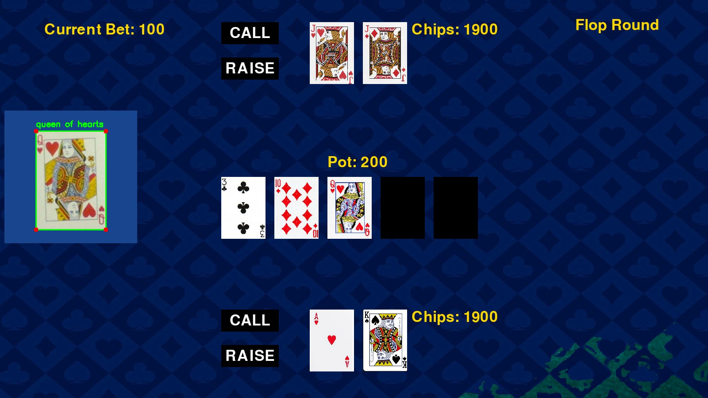

# Webcam Poker

Play two-player Texas Hold’em with a physical deck and a webcam. OpenCV finds each card on a blue surface, a TensorFlow model predicts its rank and suit, and a keypress deals it onto the Pygame table.



*The detector reads the queen of hearts shown on the flop. This sample hand replays bundled card images through the game’s camera input.*

Full Video Demo : https://youtu.be/qC1UwBvXfLo

## Play your first hand

You’ll need 64-bit Python 3.11, a webcam, a deck of cards, and a plain blue surface. The trained models are included.

**Windows PowerShell**

```powershell
git clone https://github.com/Awee3/video-image-processing.git
cd video-image-processing
python -m venv .venv
.\.venv\Scripts\Activate.ps1
python -m pip install -r requirements.txt
$env:CARD_CAMERA_INDEX = "0"
python games/poker.py
```

On macOS or Linux, create the environment with `python3 -m venv .venv`, activate it with `source .venv/bin/activate`, and select the webcam with `export CARD_CAMERA_INDEX=0`. Change the index if you use a second camera.

1. Click **Play**. Place one card face up on the blue surface with all four corners in view.
2. Press **S** when the label matches the card. Scan two cards for Player 1, two for Player 2, then five community cards. The game rejects duplicates.
3. Each player clicks **Call** or **Raise**. Once both players act, the table reveals the flop, turn, and river over successive rounds.

At showdown, the game compares each player’s best five-card hand category. Two hands in the same category count as a draw, even when their ranks or kickers differ.

## From camera to card

OpenCV masks the blue background in HSV, finds a four-corner contour, and warps the card into a square. The poker model takes a normalized **128 × 128 grayscale** image and scores 52 rank-and-suit labels. The game uses the accepted label to load the matching card face. [Class labels](model/class_mapping.txt) · [Card artwork](assets/cards/)

## Other ways to use the project

Run these commands from the repository root with the virtual environment active.

| Program | Command | What to try |
| --- | --- | --- |
| Standalone detector | `python vision/detect_cards.py` | See the predicted card and its confidence. Press **Q** in the camera window to quit. |
| Three-card blackjack | `python games/blackjack.py` | Click **Start** to scan. Press **S** to accept a card and **Q** to return to the table. Alternate dealer and player for three cards each. |
| Poker with a random opponent hand | `python games/poker_vs_random.py` | Scan your two cards and the board. The game deals the second hand from the remaining deck. |
| Capture card images | `python vision/capture_cards.py` | Click **Simpan Gambar** to save perspective-corrected JPEGs in `captures/`. This tool uses Tkinter. |

All camera tools read `CARD_CAMERA_INDEX`. With the variable unset, poker uses camera 2, blackjack uses camera 1, and the vision tools use camera 0.

## Data and training

The training scripts read **7,509 images across 52 cards**. This includes 7,498 images from Gerry’s *Cards Image Dataset–Classification* and 11 of the card faces used by the game. [Training images](dataset_kaggle/) · [Kaggle dataset](https://www.kaggle.com/datasets/gpiosenka/cards-image-datasetclassification)

The project also includes **298 webcam crops** of the ace of spades, king of diamonds, queen of hearts, and seven of clubs. [Webcam samples](dataset_self/)

To train the grayscale poker classifier from the included images, install the training dependencies and start the trainer.

```bash
python -m pip install -r training/requirements.txt
python training/train_grayscale.py
```

Each trainer writes its model and label map under `training/runs/`. The RGB CNN and MobileNetV2 experiments are alongside the grayscale trainer. MobileNetV2 downloads ImageNet weights on its first run. [Training scripts](training/) · [Bundled models](model/)

The recorded 30-epoch grayscale run reached **74.30% validation accuracy** at epoch 20 and finished at **72.84%** on its 10% validation split. [Epoch log](training/history/grayscale.log)
